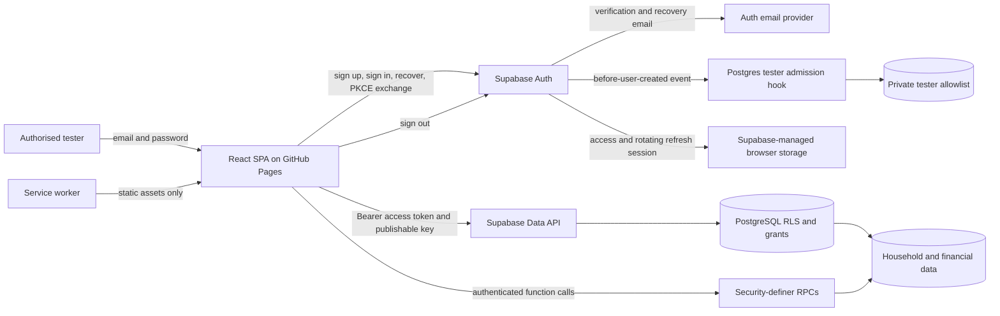

# Authentication architecture and threat audit

Audit date: 20 October 2026  
Branch: `security/01-auth-threat-audit`  
Verified base: `password` at `86e32cd8fa89dafd4a7ec680dc48f71d12d1f48d`  
Scope: repository evidence and safe local/test verification only  
Status: security baseline, not a penetration test or certification

## Executive assessment

Buddy Budget is a static React/Vite application that delegates identity, credential verification,
email verification, recovery, session issuance, and token rotation to Supabase Auth. The browser
uses Authorization Code with PKCE and persists the Supabase session. React route guards improve
navigation but are not authorization controls. PostgreSQL row-level security (RLS), constrained
foreign keys, household-role helpers, and narrowly granted functions are the real financial-data
authorization boundary.

The repository has a strong database-isolation baseline. Dedicated pgTAP tests verify anonymous
denial, forged ownership rejection, cross-user CRUD isolation, household roles, adviser scope,
function grants, and fixed `search_path` on security-definer routines. The client also avoids
caching Supabase responses, clears query data when identity changes, and gives the service worker
no runtime response cache.

Private authorised testing is nevertheless **conditional** on deployment configuration. The
repository contains a secure tester-allowlist hook, but local configuration deliberately disables
it and cannot prove that production enables it. No MFA enrollment or authenticator-assurance-level
enforcement exists. CAPTCHA, leaked-password screening, Auth rate limits, session timeouts, SMTP,
redirect allowlists, and hosted password settings are owner-controlled and unverified. Persisted
browser tokens remain exposed to same-origin script execution or a compromised device. Account
deletion is a destructive authenticated RPC but does not require recent authentication.

No P0 code-level cross-user bypass was found in the reviewed repository. `AUTH-001` remains a P0
deployment blocker because an incorrectly configured hosted project could permit unauthorised
registration despite the stated tester-only operating model.

## Scope and method

Reviewed evidence includes:

- `src/features/auth`, `src/app/providers/AuthProvider.tsx`, route guards and router definitions;
- Supabase client construction, browser storage cleanup, query keys, PWA caching, and CSP;
- all migrations through `202610170001_add_tester_signup_allowlist.sql`;
- pgTAP, Vitest, Playwright, compliance boundary, build, and CI configuration;
- account deletion, backup reauthentication, household/adviser authorization, and public sharing;
- existing compliance, architecture, database, deployment, incident, and security documents;
- current official Supabase documentation for sessions, PKCE, rate limits, CAPTCHA, MFA, hooks,
  passwords, and sign-out behavior.

The audit did not attempt production login, send email, use production accounts, inspect private
Supabase Dashboard settings, brute-force credentials, or exfiltrate data. Findings use:

- **CONFIRMED**: directly supported by repository or local catalog/test evidence.
- **LIKELY**: strongly indicated but dependent on a hosted setting or operating condition.
- **POSSIBLE**: requires owner, provider, or deployment evidence.

Priorities are remediation priorities: P0 release-blocking, P1 high, P2 medium, P3 low.

## Verified architecture



### Trust and enforcement boundaries

| Boundary         | Purpose                                                                       | Actual enforcement                                                 | Repository evidence                                   |
| ---------------- | ----------------------------------------------------------------------------- | ------------------------------------------------------------------ | ----------------------------------------------------- |
| Browser form     | Input quality and user feedback                                               | Zod only; bypassable by direct API calls                           | `src/shared/validation/schemas.ts`, auth pages        |
| Route guard      | Navigation and loading UX                                                     | React session state; not an authorization boundary                 | `src/features/auth/RouteGuards.tsx`                   |
| Supabase Auth    | Credential verification, email verification, session issuance, PKCE, recovery | Hosted/local Auth service configuration                            | `src/data/supabase/client.ts`, `supabase/config.toml` |
| Tester admission | Reject non-approved registrations                                             | Before-user-created database hook only when enabled in Auth        | migration `202610170001`, pgTAP `0019`                |
| Data API         | Accept authenticated database requests                                        | JWT role plus PostgreSQL grants and RLS                            | migrations and pgTAP `0001`, `0018`                   |
| RPC              | Atomic or privileged domain operation                                         | Execution grants, `auth.uid()`, household roles, fixed search path | migrations, pgTAP suite                               |
| Browser storage  | Session continuity                                                            | Supabase-managed persisted session; readable by same-origin script | `persistSession: true` in `client.ts`                 |
| Query cache      | In-memory authenticated data                                                  | Cleared on identity/household change                               | `AuthProvider.tsx`, `HouseholdProvider.tsx`           |
| PWA cache        | Offline public shell                                                          | Static precache only; Auth/API routes denied and no runtime cache  | `src/pwa/cachePolicy.ts`, `noStoreFetch.ts`           |
| CI               | Regression and secret controls                                                | Web checks, pgTAP stack, compliance checks, audit, build, gitleaks | `.github/workflows/quality.yml`                       |

## Authentication flow map

### Registration and verification

1. `/auth/register` validates an email, a 10–128 character password, and required testing-terms
   acknowledgement in the browser.
2. The SPA calls `supabase.auth.signUp`, sends exact callback URL, and places the acknowledgement
   versions and timestamp in user metadata.
3. If the hosted before-user-created hook is enabled, `authorize_tester_signup` normalizes the
   email, requires an unexpired private allowlist entry, and requires the two expected notice
   versions. Browser roles cannot read the allowlist or execute the hook.
4. Supabase creates the Auth identity. `on_auth_user_created` creates profile/preferences and later
   household adoption logic assigns the initial household.
5. Hosted deployments are documented to require email confirmation. The callback receives a
   short-lived one-use PKCE authorization code and calls `exchangeCodeForSession`.

Enforcement caveat: the UI statement “authorised testers only” has no security effect. The hook
must be enabled in each hosted Auth project. Local configuration intentionally sets it disabled.

### Password sign-in

1. `/auth/sign-in` uses the same schema as registration and calls `signInWithPassword`.
2. Supabase verifies the password and returns an access/refresh session.
3. `AuthProvider` restores the session with `getSession`, subscribes to Auth changes, and clears
   account-scoped caches if the authenticated identity changes.
4. The access token is attached to Data API/RPC calls. RLS and function checks determine access.

The shared 10-character client schema can prevent an existing account with a shorter provider-
accepted password from reaching Auth. Conversely, direct Auth calls bypass the browser minimum
unless the hosted password policy matches it.

### Password recovery and update

1. `/auth/forgot-password` calls `resetPasswordForEmail` with the exact reset URL.
2. Successful requests always show “If an account exists”, limiting user enumeration in the normal
   success path. Provider errors, including rate limiting, are displayed.
3. `/auth/reset-password` manually exchanges the PKCE code. A code-less visit also accepts any
   already restored session.
4. The page calls `updateUser` with the new password and navigates to the application.

No repository control requires recent authentication for an already signed-in session changing
its password. Hosted `secure_password_change` is unverified.

### Logout and account switching

1. Normal logout calls Supabase `signOut()` with its JavaScript default global scope.
2. Supabase removes the browser session and revokes affected refresh sessions. Already issued
   access tokens remain usable until their expiry unless a sensitive operation additionally checks
   the Auth session record.
3. `AuthProvider` clears TanStack Query and Buddy Budget account-scoped transient keys when the
   identity becomes null or changes.
4. Account deletion uses local-only sign-out because the Auth identity has already been removed.

### Account deletion and high-impact operations

The user types `DELETE`; `delete_own_account()` derives `auth.uid()`, blocks unsafe household-owner
deletion, and deletes the Auth identity transactionally. The RPC does not inspect authentication
age or require the current password. Full backup replacement does perform password
reauthentication and a recent-JWT database check, demonstrating an existing reusable pattern.

### MFA

No MFA enrollment, challenge, recovery, factor-management UI, `aal2` route gate, JWT AAL policy,
or privileged-operation AAL check was found. Supabase supports MFA, but capability at the provider
does not protect Buddy Budget until enrollment and enforcement are implemented and tested.

## Assets and threat actors

### Assets

- passwords and password verifiers managed by Supabase Auth;
- access tokens, rotating refresh tokens, PKCE verifier, and Auth session identifiers;
- verified email address and tester admission state;
- household membership, adviser grants, activity history, and role assignments;
- detailed budgets, transactions, goals, schedules, reports, backups, and notification metadata;
- service-role, database, email-provider, Cron/Vault, and deployment credentials;
- recovery email channel and downloadable exports.

### Threat actors

- unauthorised internet visitor or automation targeting public Auth endpoints;
- credential-stuffing attacker using reused credentials;
- attacker controlling the victim's email account or phishing a recovery/verification link;
- malicious household member, viewer, editor, adviser, or removed member;
- same-origin script introduced through XSS or compromised dependency/build pipeline;
- person with access to an unlocked shared device or browser profile;
- compromised Supabase/GitHub/Mailjet administrator or leaked server credential;
- accidental operator misconfiguration of Auth, redirect, hooks, rate limits, or secrets.

## Threat analysis

| Threat                     | Existing controls                                                                                                             | Residual exposure                                                                                                            |
| -------------------------- | ----------------------------------------------------------------------------------------------------------------------------- | ---------------------------------------------------------------------------------------------------------------------------- |
| Credential stuffing        | Supabase rate limits; 14-character new-password minimum in the client and local Auth; global logout; RLS limits account scope | Hosted limits/CAPTCHA/leaked-password screening unverified; no MFA; public sign-in endpoint                                  |
| User enumeration           | Recovery success and Auth failure copy are generic; tester hook returns one generic denial                                    | Hosted email/autoconfirm behavior and provider-side responses are unverified                                                 |
| Registration abuse         | Private expiring allowlist and server-side hook; email confirmation is required by docs                                       | Hook is disabled locally and hosted enablement is unverified; no CAPTCHA in repository                                       |
| Phishing                   | PKCE one-use short-lived code; exact application-generated callback/reset URLs                                                | Email templates, sender domain, redirect allowlist, and SMTP identity are owner-controlled; no in-app anti-phishing guidance |
| Token theft                | CSP blocks third-party scripts; no `dangerouslySetInnerHTML`; dependency/secret checks; one-hour local JWT; refresh rotation  | Tokens persist in script-readable storage; same-origin XSS or device compromise can use them; no MFA/AAL or session UI       |
| Reset abuse                | Generic response; PKCE code required by the reset route; provider recovery throttles                                          | CAPTCHA, hosted limits, and secure-password-change setting remain unverified                                                 |
| Cross-user access          | RLS on every public table; least-privilege grants; ownership/household checks; extensive pgTAP                                | A stolen valid session has all permissions of its user; hosted catalog drift remains possible                                |
| Privilege escalation       | Fixed empty search path; browser roles cannot run trigger/server functions; service role absent from client                   | Service-role Edge Functions and Dashboard access require operational verification                                            |
| Cached data after logout   | Query cancellation/clear; account transient-state cleanup; no API/service-worker runtime cache                                | Supabase Auth storage remains until SDK sign-out completes; device/browser memory is outside app control                     |
| Revoked-session use        | Refresh-token rotation and global sign-out                                                                                    | JWT remains valid up to configured expiry; most RLS checks do not query `auth.sessions` per request                          |
| CI/supply-chain compromise | Lockfile install, npm high-severity audit, gitleaks, CSP, no runtime third-party scripts                                      | Actions use version tags rather than immutable SHAs; no SBOM/provenance or dependency-review gate                            |

## Prioritized findings

| ID       | Priority | Classification                     | Finding                                                                                                                                                                                                                    | Evidence                                                                                                       | Safe local/test reproduction                                                                                                                                                                             | Recommendation                                                                                                                                                     |
| -------- | -------- | ---------------------------------- | -------------------------------------------------------------------------------------------------------------------------------------------------------------------------------------------------------------------------- | -------------------------------------------------------------------------------------------------------------- | -------------------------------------------------------------------------------------------------------------------------------------------------------------------------------------------------------- | ------------------------------------------------------------------------------------------------------------------------------------------------------------------ |
| AUTH-001 | P0       | CONFIRMED / hosted status POSSIBLE | Tester-only registration depends on a Dashboard hook that the repository cannot prove is enabled. Local config disables it.                                                                                                | `supabase/config.toml`; migration `202610170001`; `docs/compliance/gap-register.md`                            | In a disposable local stack, confirm signup succeeds while the hook is disabled; enable it only in a disposable project and confirm an absent/expired address is denied. Never use production addresses. | Treat hosted hook evidence as a release gate; reject a disposable non-allowlisted signup; document owner/date/project without storing the allowlist.               |
| AUTH-002 | P1       | CONFIRMED                          | No MFA enrollment, challenge, recovery, AAL route gate, or database AAL enforcement exists.                                                                                                                                | No Auth MFA calls or AAL policies found in `src` or migrations                                                 | Search for MFA/AAL calls; in disposable staging, enroll TOTP only after a dedicated implementation exists and test that `aal1` cannot perform protected actions.                                         | Add optional TOTP first, then require `aal2` for destructive/export/share/role operations; provide recovery and lockout support.                                   |
| AUTH-003 | P1       | CONFIRMED / hosted status POSSIBLE | New-password strength is client-only at 10 characters; local Auth config does not match it. The same schema also blocks legacy shorter-password sign-in.                                                                   | `schemas.ts`, `RegisterPage.tsx`, `ResetPasswordPage.tsx`, `SignInPage.tsx`, `supabase/config.toml`            | Unit-test 9/10/128/129 boundaries; use a disposable account created directly with provider-accepted policy to prove client/server mismatch.                                                              | Use separate create/reset and sign-in schemas; adopt a length-first server policy, leaked-password screening where available, and identical hosted/local settings. |
| AUTH-004 | P1       | CONFIRMED                          | Account deletion requires typed confirmation but not recent authentication or MFA. A stolen active session can invoke the destructive RPC directly.                                                                        | `SettingsPage.tsx`; `requestAccountDeletion`; `delete_own_account()`                                           | With a disposable local account, call the RPC using its current session without entering a password and confirm deletion proceeds.                                                                       | Require recent Auth proof server-side; prefer AAL2 when available. Preserve transactionality and local-session cleanup.                                            |
| AUTH-005 | P1       | CONFIRMED / inherent architecture  | Access and refresh tokens persist in browser storage and are readable by same-origin JavaScript.                                                                                                                           | `persistSession: true`; Supabase SPA behavior; architecture docs                                               | In a disposable browser profile, inspect Application storage after login without copying token values into evidence.                                                                                     | Preserve strict CSP/no-third-party-script posture; add dependency controls and session management. Reassess a BFF only if risk/operations justify it.              |
| AUTH-006 | P1       | POSSIBLE                           | Hosted CAPTCHA, leaked-password protection, Auth endpoint limits, SMTP identity, and abuse monitoring are unverified.                                                                                                      | No CAPTCHA integration; config omits rate-limit/security settings; Dashboard inaccessible to repository review | Capture redacted Dashboard screenshots/exports; use the bounded staging procedure in `auth-abuse-protection.md`. Never brute force production.                                                           | Approve settings per environment, add CAPTCHA only with its frontend token integration, and alert on aggregate Auth failures without logging credentials.          |
| AUTH-007 | P2       | CONFIRMED                          | Password reset accepts any already restored session when no PKCE code is present, and hosted secure-password-change enforcement is unverified.                                                                             | `ResetPasswordPage.tsx`; `supabase/config.toml`                                                                | Visit `/auth/reset-password` while signed in to a disposable local account and verify the form becomes ready without a recovery code.                                                                    | Separate recovery-code completion from authenticated password change; require recent auth for the latter and enable secure password change.                        |
| AUTH-008 | P2       | CONFIRMED / hosted status POSSIBLE | Redirect construction is exact and base-aware, but the hosted site URL and allowlist are not repository-verifiable. An overly broad allowlist increases phishing/code-delivery risk.                                       | `authUrls.ts`; README/deployment docs                                                                          | In staging, test only exact callback/reset URLs and confirm an unlisted origin is rejected.                                                                                                              | Keep exact HTTPS production/staging entries, remove localhost from production, and record verification evidence.                                                   |
| AUTH-009 | P2       | CONFIRMED                          | Default global logout is intentional but undocumented in UI; revoked access JWTs may remain valid for up to one hour. There is no session/device management screen.                                                        | `AuthProvider.tsx`; local `jwt_expiry = 3600`; Supabase sign-out semantics                                     | Use two disposable browser profiles; global logout one and confirm refresh eventually fails in the other without attempting production use.                                                              | Document global logout, add session visibility/revoke controls, and require live-session checks only for narrowly selected high-risk actions.                      |
| AUTH-010 | P2       | CONFIRMED                          | Provider error strings are rendered directly on Auth forms. This couples UX to provider wording and can disclose configuration or enumeration-relevant distinctions.                                                       | sign-in, registration, recovery, callback, reset pages                                                         | Mock distinct Auth errors in component tests and observe exact provider text displayed.                                                                                                                  | Map errors to stable generic user messages; retain non-sensitive diagnostic codes only in controlled monitoring.                                                   |
| AUTH-011 | P2       | CONFIRMED                          | CI has strong tests and gitleaks, but third-party Actions use mutable major tags and no dependency-review/SBOM/provenance control is present.                                                                              | `.github/workflows/*.yml`                                                                                      | Review resolved Action commits in a test PR and run `npm audit`; no production credentials required.                                                                                                     | Pin security-sensitive Actions to reviewed commit SHAs and add dependency review/provenance according to repository risk appetite.                                 |
| AUTH-012 | P3       | CONFIRMED                          | Auth coverage is uneven: provider/cache and route-guard tests exist, but recovery, callback replay/error mapping, logout scope, registration-hook integration, and MFA absence have no complete browser/integration suite. | Auth tests, E2E inventory, CI workflow                                                                         | Run current focused tests and list missing cases; use disposable local accounts only.                                                                                                                    | Add a dedicated deterministic Auth regression suite after policy decisions are approved.                                                                           |
| AUTH-013 | P2       | CONFIRMED                          | The locked Vite 8.3.0 dependency has a high-severity `launch-editor` advisory affecting local Windows development behavior; the production static bundle does not run the development server.                              | `package-lock.json`; `npm audit --audit-level=high` on 20 October 2026                                         | Run the repository audit without starting a public development server; review the linked advisories.                                                                                                     | Upgrade to a patched Vite release through a dedicated dependency PR, then rerun build, PWA, direct-route, and Windows/WSL development checks.                      |

## Implementation progress

This table records repository-controlled remediation completed after the baseline audit. It does
not close hosted Supabase or owner-dependent verification work.

| Finding  | Repository status | Evidence                                                                                                                                                                                                                                                                                                                                                              | Remaining work                                                                                                                                              |
| -------- | ----------------- | --------------------------------------------------------------------------------------------------------------------------------------------------------------------------------------------------------------------------------------------------------------------------------------------------------------------------------------------------------------------- | ----------------------------------------------------------------------------------------------------------------------------------------------------------- |
| AUTH-002 | PARTIAL           | Opt-in TOTP enrollment, multi-factor challenge selection, an authenticated route gate, AAL2 factor removal and account deletion, plus database-enforced AAL2 household and adviser financial access for enrolled accounts are implemented. See `mfa.md`, `session-and-financial-authorization.md`, and migrations `202610240001`, `202610250001`, and `202610250002`. | Verify hosted settings and disposable staging flows; approve administrator-assisted recovery.                                                               |
| AUTH-003 | PARTIAL           | New/reset passwords require at least 15 Unicode code points and no more than 72 UTF-8 bytes; sign-in remains legacy-compatible; local Auth requires 15 bytes. See `password-policy.md`.                                                                                                                                                                               | Match and verify the hosted Auth policy. Exact server-side Unicode code-point enforcement is blocked by the provider's byte-counting behavior.              |
| AUTH-004 | PARTIAL           | Account deletion reauthenticates with the current password; migrations `202610200001` and `202610240001` reject missing/stale password authentication and require AAL2 when a verified factor exists.                                                                                                                                                                 | Validate the combined password-plus-TOTP deletion flow with a disposable staging account.                                                                   |
| AUTH-006 | PARTIAL           | Provider `weak_password` responses receive safe actionable guidance; HTTP 429/provider throttling receives accessible retry guidance; password-reset requests use a neutral completion response. `breached-password-protection.md` and `auth-abuse-protection.md` document provider deployment and bounded staging tests.                                             | Verify hosted rate limits and monitoring; decide on and integrate CAPTCHA before enabling it; enable and verify leaked-password protection on Pro or above. |
| AUTH-007 | PARTIAL           | The reset route requires a recovery PKCE exchange, removes the authorization code from the address bar, globally revokes sessions after a successful password update, and local Auth enables secure password changes. See `account-recovery.md`.                                                                                                                      | Verify hosted secure-password-change, password-change notifications, exact redirects, expiry, replay, and real recovery email delivery in staging.          |
| AUTH-010 | COMPLETE          | Sign-in, registration, recovery, reset, and callback pages map provider failures to stable operation-specific messages; tests reject raw provider output.                                                                                                                                                                                                             | Controlled diagnostic monitoring remains an optional operational improvement.                                                                               |
| AUTH-012 | PARTIAL           | Added password-boundary, provider-redaction, recovery-code, deletion reauthentication, stale-claim, and valid recent-claim regression tests.                                                                                                                                                                                                                          | Add disposable-account browser coverage for email delivery, callback replay, global logout, and future MFA.                                                 |
| AUTH-013 | COMPLETE          | Vite is locked to patched version 8.3.4; the high-severity dependency audit reports no vulnerabilities.                                                                                                                                                                                                                                                               | Continue normal dependency monitoring.                                                                                                                      |

## Control inventory

### Preventive controls

- Supabase-managed password hashing and credential verification; no password is stored by the SPA.
- Authorization Code with PKCE, manual one-time code exchange, and exact base-aware callback URLs.
- Private tester allowlist table inaccessible to browser roles; hook execution limited to
  `supabase_auth_admin`.
- Email verification required by deployment documentation and required before accepting household
  or adviser invitations.
- Browser configuration accepts HTTPS Supabase URLs, with loopback HTTP limited to development.
- No service-role/database/email-provider secret is referenced by browser code.
- Restrictive meta CSP; no `dangerouslySetInnerHTML` or runtime third-party analytics script found.
- RLS enabled across public tables; anonymous table/function access revoked.
- Security-definer functions set an empty `search_path`, derive caller identity, and use narrow
  execution grants.
- Household owner/editor/viewer and adviser read-only permissions enforced in PostgreSQL.
- Static PWA precache only; Auth/Data API responses use `cache: no-store`.

### Detective controls

- Append-only household and adviser activity events for selected material actions/access.
- CI runs formatting, lint, typecheck, unit tests, compliance checks, high-severity dependency
  audit, production builds, public-route Playwright checks, gitleaks, and the full pgTAP suite.
- pgTAP catalog assertions detect missing RLS, unsafe grants, anonymous execution, trigger-function
  execution, and unsafe security-definer search paths.
- Incident documentation identifies current provider logs and explicitly records the lack of a
  centralized SIEM/automated alerting system.

### Responsive and recovery controls

- Global sign-out by default, rotating refresh tokens, and one-hour local access-token expiry.
- Query cancellation/cache clearing and account-scoped transient-state cleanup on identity change.
- Generic password-recovery success and Auth failure wording.
- Recovery-only password reset handling and server-enforced recent password authentication for
  account deletion.
- Transactional account deletion with explicit household-owner safeguards and honest failure UI.
- Incident-response, breach-notification, and tabletop documents exist; operational ownership and
  exercises remain owner-dependent.

## Migration and compatibility constraints

1. Do not edit applied migrations. Database/Auth-hook changes require a new forward migration and
   a pgTAP catalog/behavior test.
2. Supabase Dashboard Auth settings are not database migrations. Each environment needs separately
   recorded settings and drift verification.
3. Do not enable the tester hook locally without preserving an explicit, documented developer path;
   never copy real tester addresses into seed data or repository fixtures.
4. Password-policy increases apply to creation/reset, not existing password hashes. Sign-in must
   continue accepting legacy credentials until the provider verifies them.
5. MFA rollout must avoid lockout: implement enrollment, verification, recovery, factor removal,
   support procedure, and tests before requiring AAL2. Add AAL checks at PostgreSQL/Edge boundaries,
   not only in React.
6. A shorter JWT expiry increases refresh frequency and operational failure modes. Keep session
   lifetime, inactivity, single-session, and JWT settings consistent with plan capabilities and
   tested PWA behavior.
7. A backend-for-frontend would change hosting, CSRF, cookies, refresh rotation, caching, incident
   response, and cost. Do not treat it as a small storage refactor.
8. Callback/reset changes must preserve GitHub Pages base paths, `404.html` query restoration, PKCE
   query parameters, and same-browser verifier availability.
9. Preserve RLS and role enforcement even if route guards or MFA are added. Client controls never
   replace database authorization.
10. High-risk reauthentication must be enforced by the server/RPC using trusted Auth claims or
    session state; a client-only timestamp is insufficient.

## Prioritized remediation backlog

### Phase 02 — Deployment Auth baseline (P0/P1)

1. Close `AUTH-001`: prove tester hook, email confirmation, exact redirects, and signup rejection in
   staging and production.
2. Finish `AUTH-003` and `AUTH-006`: align the hosted password policy, leaked-password screening,
   rate limits, and CAPTCHA decision. Generic Auth error mapping is implemented.
3. Add an Auth configuration evidence template that contains settings and timestamps but no secrets
   or tester email list.

### Phase 03 — Sensitive-action reauthentication (P1)

1. Define which actions require recent authentication: deletion, full restore, ownership transfer,
   public financial sharing, adviser export, and MFA-factor changes.
2. Implement one server-verifiable recent-auth contract and reuse it consistently.
3. Add disposable-account integration tests for stale session, valid reauthentication, replay, and
   provider failure.

### Phase 04 — MFA and session management (P1/P2)

1. Add TOTP enrollment/challenge/recovery UX and accessible factor status.
2. Enforce AAL2 at database/Edge boundaries for approved high-risk actions.
3. Add session/device visibility, current-session identification, and deliberate local/global revoke
   controls without exposing raw identifiers or tokens.

### Phase 05 — Monitoring and regression (P2)

1. Add privacy-minimised Auth failure/abuse signals and an owner-tested alert route.
2. Expand Auth Vitest/Playwright coverage and Dashboard drift checks.
3. Pin critical CI Actions and add dependency review/provenance evidence.
4. Keep `AUTH-013` closed by retaining patched Vite releases and the high-severity dependency audit.

## Supabase Dashboard verification checklist

Record project, environment, reviewer, date, and redacted evidence location. Do not paste secrets,
tokens, real tester addresses, password hashes, or recovery links into repository documents.

### Authentication providers and admission

- [ ] Email/password is the only intended enabled provider, or every additional provider has a
      separate threat review.
- [ ] Email confirmation is required in staging and production.
- [ ] Before-user-created hook points exactly to `public.authorize_tester_signup` and is enabled.
- [ ] A disposable allowlisted address succeeds and a disposable absent/expired address fails.
- [ ] Anonymous sign-in, phone auth, manual identity linking, and unreviewed OAuth providers are off.

### URLs and email

- [ ] Site URL is the exact HTTPS deployed application root.
- [ ] Redirect allowlist contains only exact approved callback/reset URLs for that environment.
- [ ] Production has no localhost or broad wildcard redirects.
- [ ] Recovery/verification templates preserve the provider confirmation URL and contain no secrets.
- [ ] Sender identity, SPF/DKIM/DMARC, delivery, and provider escalation are verified by the owner.

### Passwords, abuse, and sessions

- [ ] Hosted minimum password length and required-character policy match the approved client policy.
- [ ] Leaked-password protection status is recorded and enabled where available/approved.
- [ ] CAPTCHA decision covers sign-up, sign-in, and recovery; keys remain provider-side as required.
- [ ] Auth endpoint/email/token/verification rate limits are recorded and staging-tested safely.
- [ ] JWT expiry, refresh-token rotation, reuse interval, inactivity/time-box, and single-session
      settings match the approved risk and plan capabilities.
- [ ] Secure password change / reauthentication setting is enabled and tested.
- [ ] MFA factor types and maximum enrolled factors match the implemented product behavior.

### Authorization and operations

- [ ] Database Linter has no unresolved Auth/RLS/security-definer findings.
- [ ] Migration `202610150001` and tester-hook migration `202610170001` are in migration history.
- [ ] A staging pgTAP run proves no anonymous public-table/function access and no unsafe browser
      grants.
- [ ] Service-role and database credentials exist only in approved secret stores and have owners and
      rotation dates.
- [ ] Project administrators use MFA and least privilege; departed members are removed.
- [ ] Auth/audit logs, alert access, retention, incident contacts, backups, and restore drill are
      verified without exporting sensitive payloads.

## Safe reproduction commands

Run from WSL against local Supabase and disposable fixtures only:

```bash
npm ci
npx supabase start -x studio,imgproxy,edge-runtime,logflare,vector,supavisor
npm run test:db
npm test -- --run src/app/providers/AuthProvider.test.tsx src/features/auth/RouteGuards.test.tsx src/features/auth/RegisterPage.test.tsx
npm run test:compliance
```

Do not aim automated password guesses at hosted Auth, inspect real browser token values, reuse a
production identity, or place screenshots containing email addresses, tokens, project secrets, or
financial data in CI artifacts.

## Verification evidence

Baseline commands ran through WSL on 20 October 2026. Remediation checks were rerun on 21 October
2026 against the checked-out branch and disposable local Supabase stack:

| Check                                                   | Result                                                                                                            |
| ------------------------------------------------------- | ----------------------------------------------------------------------------------------------------------------- |
| Focused Prettier check for task-owned Markdown/TS files | PASS                                                                                                              |
| Repository ESLint                                       | PASS                                                                                                              |
| TypeScript project build                                | PASS                                                                                                              |
| Vitest                                                  | PASS — 60 files, 191 tests                                                                                        |
| Compliance boundary tests                               | PASS — 4 tests and live boundary scan                                                                             |
| Production Vite/PWA build                               | PASS — Vite 8.3.4, 96 precache entries                                                                            |
| Registration Playwright flow                            | PASS — Chromium and Android Chrome                                                                                |
| pgTAP                                                   | PASS — 22 files, 385 assertions                                                                                   |
| Gitleaks 8.24.3 on task-owned changes, redacted output  | PASS — no leaks found                                                                                             |
| `npm audit --audit-level=high`                          | PASS — no vulnerabilities                                                                                         |
| Repository-wide Prettier check                          | BLOCKED — four pre-existing unrelated files remain: one compliance document, two Help files, and `src/styles.css` |

The first no-git scan of the whole working directory reported the ignored local Supabase
publishable configuration in `.env.local` and its generated `dist` copy. These browser-safe local
artifacts are untracked and outside this PR. No credential value was copied into this document or
the handoff. CI's tracked-history gitleaks action remains the authoritative pull-request scan.

## Owner decisions and unresolved evidence

- Approve the password policy, leaked-password screening, CAPTCHA, rate-limit, session, and MFA
  posture for private testing.
- Decide whether all normal logout is intentionally global across devices.
- Approve the list of sensitive actions requiring recent auth and AAL2.
- Provide redacted evidence for hosted hook, email confirmation, redirect, Auth security, project
  member, logging, backup, and incident settings.
- Confirm who owns tester admission/revocation, Auth abuse monitoring, recovery support, and
  emergency session revocation.
- Public access or monetisation requires a new security, privacy, and legal review.

## Rollback considerations

The forward migration intentionally has no automatic rollback because removing the recent-auth
check would weaken destructive-action security. If an emergency rollback is owner-approved, deploy
a new forward migration restoring the prior function only after documenting the accepted risk. The
frontend password-policy and error-mapping changes can be reverted with an application deployment;
the hosted minimum must remain compatible with that client version. Reverting Vite requires a
different patched release, not the vulnerable 8.3.0 lock. Do not disable RLS, broaden grants, expose
the allowlist, weaken redirect restrictions, or place privileged credentials in browser variables
as rollback shortcuts.

## References

- Supabase Auth: <https://supabase.com/docs/guides/auth>
- Password Auth: <https://supabase.com/docs/guides/auth/passwords>
- PKCE: <https://supabase.com/docs/guides/auth/sessions/pkce-flow>
- Sessions: <https://supabase.com/docs/guides/auth/sessions>
- Sign-out: <https://supabase.com/docs/guides/auth/signout>
- MFA: <https://supabase.com/docs/guides/auth/auth-mfa>
- Rate limits: <https://supabase.com/docs/guides/auth/rate-limits>
- CAPTCHA: <https://supabase.com/docs/guides/auth/auth-captcha>
- Before-user-created hook: <https://supabase.com/docs/guides/auth/auth-hooks/before-user-created-hook>
